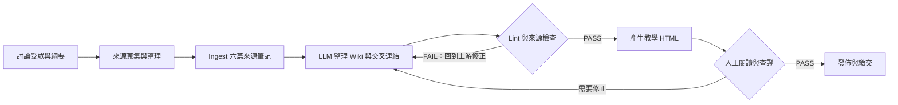

# RAG 是什麼？從 LLM Wiki 到教學 HTML 簡報

這是一份 **以 RAG 為知識主題**、依 **LLM Wiki（原始來源 → 知識頁面 → schema / ingest-query-lint）** 概念建立的教學專案。

## 立即開啟

1. 開啟 `index.html`（網站首頁）
2. `wiki.html`（可搜尋的 Wiki，含引用來源和交叉連結）
3. `slides.html`（15 頁教學簡報；桌面版可用左右方向鍵切換）
4. `workflow.html`（Loop/Graph、測試紀錄與反思）

**重要：請不要只單獨上傳 HTML。** HTML 會用到 `assets/site.css`；GitHub Pages 請保留所有資料夾結構。

## 專案結構

```text
index.html                   # 作業入口
wiki.html                    # 可瀏覽的 Wiki
slides.html                  # 教學型 HTML 簡報
workflow.html                # 製作 Graph + evidence
assets/site.css              # 網站樣式
raw/S01.md ... S06.md        # 六份具原始 URL 的來源筆記
.wiki/raw/                  # 經 ingest 寫入的來源快照
.wiki/wiki/                 # LLM 輔助撰寫的 Markdown Wiki 條目
.wiki/index.md              # Wiki 條目索引
.wiki/AGENTS.md             # Wiki 規則（schema）
.wiki/ingest_manifest.json  # 真正執行後的來源編號、hash、bytes
.wiki/log.md                # 維護紀錄
data/content.json           # 給 Wiki HTML 與 Slides 共用的知識資料
tools/ingest.py             # 把六份整理後來源筆記 ingest 進 raw 層
tools/check.py              # 驗證來源 lineage、跨頁連結、投影片映射
tools/build.py              # 通過檢查才生成 Markdown Wiki 和 HTML
templates/                  # HTML 模板
evidence/check_run.txt      # 真實執行紀錄：注入 S99 → FAIL → 修正 → PASS
evidence/*preview.png       # 瀏覽器預覽截圖
SUBMISSION.md               # 可貼到作業平台的文字草稿
```

## 核心來源（至少 5 篇）

| ID | 文獻 | 用途 |
|---|---|---|
| S01 | [Lewis et al. (2020) — RAG 原始論文](https://arxiv.org/abs/2005.11401) | RAG 定義、檢索與生成 |
| S02 | [Microsoft Learn — RAG and Indexes](https://learn.microsoft.com/en-us/azure/foundry/concepts/retrieval-augmented-generation) | 三階段、索引、搜尋 |
| S03 | [Anthropic — Contextual Retrieval](https://www.anthropic.com/research/contextual-retrieval) | 分塊、BM25、Embedding、Rerank |
| S04 | [IBM — What is RAG?](https://www.ibm.com/think/topics/retrieval-augmented-generation) | 例子、風險與限制 |
| S05 | [Es et al. (2023) — RAGAS](https://arxiv.org/abs/2309.15217) | 檢索與回答的分開評估 |
| S06 | [AWS Prescriptive Guidance — RAG options](https://docs.aws.amazon.com/prescriptive-guidance/latest/retrieval-augmented-generation-options/introduction.html) | 工程情境、架構選擇 |

`raw/` 中的是**原始網站/論文的中文重點整理**，並不是把受著作權保護的完整文章複製一份。保留 URL 供檢核。執行 `ingest.py` 時，正式將這六份來源筆記逐份寫入 `.wiki/raw/`，記錄 SHA-256 並生成 manifest。

## 如何從頭重新執行

只需要 Python 3.9+（沒有 pip 套件依賴）。在專案目錄執行：

```bash
python3 tools/ingest.py
python3 tools/check.py
python3 tools/build.py
```

- **Ingest**：將六份可追溯來源筆記寫入 raw 層；保存 SHA-256 manifest。
- **Wiki synthesis**：ChatGPT 已依上述六份資料，將教學知識整理成 `data/content.json` 與 Markdown Wiki。這部分是本次對話中的 LLM 輔助編寫成果，**不是 `ingest.py` 每次會自動呼叫線上 LLM 模型**。
- **Query**：`wiki.html` 提供互動式關鍵字搜尋；選擇條目可檢視來源與關聯概念。
- **Lint**：`check.py` 驗證六份 ingest 存在、ID、雜湊、Wiki 引用、交叉連結、投影片與 Wiki 對應。不通過會返回 exit code 1；`build.py` 不允許建立輸出。
- **Render**：只有驗證通過，才產生可在瀏覽器檢視的 HTML。

### Workflow Graph



先討論題目、初學者目標、大綱，再由 LLM 依文件整理 Wiki；正是「先討論，後生成」。

## 實際執行／反思

- 一次控制性負向測試：將 `case` 投影片來源改為不存在的 `S99`（獨立測試副本），`check.py` 回傳 `FAIL UNKNOWN_SLIDE_SOURCE case: S99`、exit code 1。
- 恢復正確來源後重跑，`PASS SOURCE_LINEAGE_AND_STRUCTURE`、exit code 0。
- 產出檢查：6 筆來源、10 個 Wiki 條目、15 頁教學投影片；可見 `evidence/check_run.txt`。
- **高風險節點**：Wiki 到投影片時的「引用來源對應」容易漏掉或引用錯誤。
- **workflow 調整**：將來源、Wiki 和投影片對應檢查移到 HTML 產生之前，錯誤不讓其流向成品。
- **仍需人工檢查**：來源是否真的支持句子、虛構案例有無誤導、教學是否清楚；程式的 PASS 不代表所有主張已完成語意查證。

## 如何取得作業需要的公開連結（GitHub Pages）

1. 在 GitHub 建立一個新 repository，例如 `rag-llm-wiki`。
2. **解壓縮專案**，把本資料夾的所有檔案與資料夾放到 repository **根目錄**（不是放進另一層 `rag-llm-wiki-homework/`）。檢查根目錄有 `index.html`。
3. 到 repository **Settings → Pages → Build and deployment**，選擇 **Deploy from a branch**，選 `main`、`/(root)`，儲存。
4. 等 GitHub Pages 顯示站點網址後，開啟首頁，依序檢查 Wiki、Slides 和 Workflow 是否可瀏覽。
5. 作業文字中貼上自己實際得到的公開網址（**不要把 sandbox 連結當成老師可存取的公開網址**）。

如果老師指定必須使用**某個特定 LLM Wiki 軟體／網站**做 ingest，這個自包含示範不等於已在該平台完成。請另在老師要求的工具中匯入上方 6 筆原始 URL（或對應檔案），留存該平台的 ingest 截圖／日志，再把 Wiki 連結填入繳交內容。

## 內容聲明

- 所有 PO-784、P-04、延誤 5 天與退貨期限的數字均為**為教學而虛構的案例**，不是實際企業文件或規定。
- 六份資料皆有其原始出處；Wiki 條目、投影片內容為原創繁體中文轉述與重組，應在正式繳交前人工核對。
- 無線上 LLM API、沒有自動模型評分，不能虛稱實際測得 RAG 檢索模型的 Hit@3 或 RAGAS 分數。
